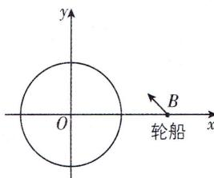

16.[河北部分学校2025高二联考]一个小岛(点O)的周围有环岛暗礁,暗礁分布在以小岛为圆心,半径为1 km的圆形区域内,轮船在小岛正东方向2 km的B点处.以小岛中心为原点O,正东方向为x轴的正方向,正北方向为y轴的正方向建立平面直角坐标系,取1 km为单位长度.

(1)若轮船沿北偏西 $45^{\circ}$ 的航向直线航行, 轮船是否会有触礁风险? 说明理由;

(2) 若直线 $l$ 过点 $B$ , 且其倾斜角为直线 $y = \frac{1}{2} x$ 的倾斜角的 2 倍, 求 $l$ 的一般式方程, 并求暗礁边界上动点 $P$ 到直线 $l$ 的距离的最小值.

