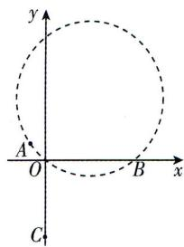

18. (本小题满分 17 分) [广西南宁 2025 高二期中]为了保证我国东海油气田海域海上平台的生产安全, 海事部门在某平台 O 的北偏西 $45^{\circ}$ 方向 $2\sqrt{2}$ km 处设立观测点 A, 在平台 O 的正东方向 12 km 处设立观测点 B, 规定经过 O, A, B 三点的圆以及其内部区域为安全预警区. 如图所示, 以 O 为坐标原点, O 的正东方向为 x 轴正方向, 建立平面直角坐标系.

(1)试写出 A, B 的坐标, 并求两个观测点 A, B 之间的距离.

(2)试求经过 O, A, B 三点的圆的标准方程.

(3)某日经观测发现, 在该平台 O 正南方向 10 km 的 C 处, 有一艘轮船正以 $8\sqrt{7}$ km/h 的速度沿北偏东 $45^{\circ}$ 方向行驶, 如果航向不变, 该轮船是否会进入安全预警区? 如果不进入, 请说明理由; 如果进入, 那么它在安全预警区内会行驶多长时间？

