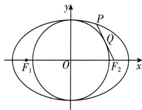

2.[安徽安庆2024高二月考]如图,圆O与椭圆相切,已知 $F_{1},F_{2}$ 分别是椭圆的左、右焦点,点P在椭圆上,线段 $PF_{2}$ 与圆O

相切于点 $Q$ ，且点 $Q$ 为线段 $PF_{2}$ 的中点，则椭圆的离心率为 （）A. $\frac{\sqrt{5}}{3}$ B. $\frac{\sqrt{3}}{5}$ C. $\frac{\sqrt{5}}{4}$ D. $\frac{\sqrt{2}}{5}$
