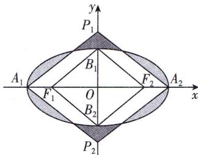

5. (多选) [广东华南师大附中 2025 高二期中] 古希腊数学家阿基米德利用“逼近法”算出椭圆面积等于圆

周率、椭圆的长半轴长、短半轴长三者的乘积.
如图,已知椭圆 $C:\frac{x^{2}}{a^{2}}+\frac{y^{2}}{b^{2}}=1(a>b>0)$ 的左、右焦点分别为 $F_{1}, F_{2}$ ，上、下顶点分别为 $B_{1}, B_{2}$ ，左、右顶点分别为 $A_{1}, A_{2}, \overrightarrow{OP_{1}}=\frac{3}{2}\overrightarrow{OB_{1}}, \overrightarrow{OP_{2}}=\frac{3}{2}\overrightarrow{OB_{2}}$ ，设 C 的离心率为 e，则（）
A. 若 $B_{1}F_{2}//P_{1}A_{2}$ ，则 $e=\frac{2}{3}$ B. 四边形 $F_{1}B_{1}F_{2}B_{2}$ 的面积与 C 的面积之比为 $\frac{2e}{\pi}$ C. 四边形 $F_{1}B_{1}F_{2}B_{2}$ 的内切圆方程为 $x^{2} + y^{2} = \frac{a^{2}(a^{2}-b^{2})}{b^{2}}$ D. 设椭圆外阴影部分的面积为 $S_{外}$ ，椭圆内阴影部分的面积为 $S_{内}$ ，则 $S_{外}<S_{内}$

## 相关知识点

暂无已审核的相关知识点。

> 来源：2026版 必刷题 数学选择性必修第一册RJA
