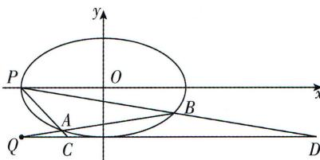

12.[2023高中数学联赛吉林预赛]已知椭圆 $M$ ： $\frac{x^2}{a^2} + \frac{y^2}{b^2} = 1 (a > b > 0)$ 经过点 $P(-2,0)$ ，且其焦距为 $2\sqrt{3}$ .

(1) 求椭圆 M 的方程;

(2) 过点 $Q(-2, -1)$ 作直线 $l$ 与椭圆 $M$ 的下半部分相交于 $A, B$ 两点, 连接 $PA, PB$ 分别交直线 $y = -1$ 于 $C, D$ 两点, 求证: $|QC| + |QD| - |QC| \cdot |QD|$ 为定值.

