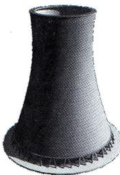

5.[重庆八中2024高二期中]如图所示,双曲线型冷却塔的外形是离心率为3的双曲线的一部分绕其虚轴旋转所成的曲面,已知该冷却塔的上口半径为3 m,下口

半径为 $4 \mathrm{~m}$ , 高为 $8 \mathrm{~m}$ (数据以外壁即冷却塔外侧表面计算), 则冷却塔的最小直径为 ( )
A. $\frac{\sqrt{574}}{8} \mathrm{~m}$ B. $\frac{\sqrt{287}}{8} \mathrm{~m}$ C. $\frac{\sqrt{574}}{4} \mathrm{~m}$ D. $\frac{\sqrt{287}}{4} \mathrm{~m}$

