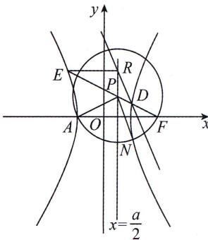

11.[重庆一中2024高二期中]已知双曲线C: $\frac{x^2}{a^2} -\frac{y^2}{3a^2} = 1(a > 0)$ 的左顶点为A,右焦点为F,P 是直线 $l:x = \frac{a}{2}$ 上一点，且P不在x轴上，以点P为圆心，线段PF的长为半径的圆弧AF交C的右支于点N.

(1) 证明: $\angle APN = 2\angle NPF$ .

(2)取 a=1 ，若直线 PF 与 C 的左、右两支分别交于 E, D 两点，过 E 作 l 的垂线，垂足为 R ，判断直线 DR 是否过定点？若是，求出定点的坐标；若不是，请说明理由.

## 相关知识点

暂无已审核的相关知识点。

> 来源：2026版 必刷题 数学选择性必修第一册RJA
