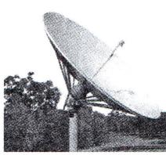
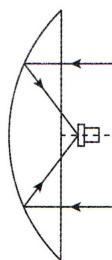

4.[江苏常州2024高二期中]某学习小组研究一种卫星接收天线(如图①所示),发现其曲面与轴截面的交线为抛物线,在轴截面内的卫星波束呈近似平行状态射入形为抛物线的接收天线,经反射聚焦到焦点处(如图②所示).已知接收天线的口径(直径)为3.6m,深度为0.6m,则该抛物线的焦点到顶点的距离为()

图①
图②

A. $1.35 \mathrm{~m}$ B. $2.05 \mathrm{~m}$ C. $2.7 \mathrm{~m}$ D. $5.4 \mathrm{~m}$

