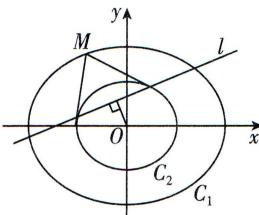

2.[江西师大附中2025高二期中]从椭圆 $C:\frac{x^{2}}{a^{2}}+\frac{y^{2}}{b^{2}}=1(a>b>0)$ 外一点

$P(x_{0},y_{0})$ 向椭圆引两条切线, 切点分别为 A, B, 则直线 AB 称作点 P 关于椭圆 C 的极线, 其方程为 $\frac{x_{0}x}{a^{2}}+\frac{y_{0}y}{b^{2}}=1$ . 现有如图所示的两个椭圆 $C_{1}, C_{2}$ , 离心率分别为 $e_{1}, e_{2}, C_{2}$ 内含于 $C_{1}$ , 椭圆 $C_{1}$ 上的任意一点 M 关于 $C_{2}$ 的极线为 l, 若原点 O 到直线 l 的距离为 1, 则 $e_{1}^{2}-e_{2}^{2}$ 的最大值为 ( )
A. $\frac{1}{2}$ B. $\frac{1}{3}$ C. $\frac{1}{5}$ D. $\frac{1}{4}$

