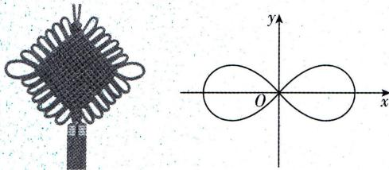

11.[四川南充2025高二期中]中国结是一种传统的民间手工艺术,有浓厚的中华民族文化特色,它有着复杂奇妙的曲线.用数学的眼光思考可以还原成单纯的二维线条,其中“∞”对应着数学曲线中的双纽线.在xOy平面上,把到两个定点 $F_{1}(-a,0)$ , $F_{2}(a,0)$ 距离之积等于 $a^{2}(a>0)$ 的动点轨迹称为双纽线.已知双纽线 $C:(x^{2}+y^{2})^{2}=9(x^{2}-y^{2})$ ,P是曲线C上的一个动点,下列结论正确的是()

A. 曲线 C 上满足 $\left|PF_{1}\right|=\left|PF_{2}\right|$ 的点 P 有且只有一个
B. 曲线 C 经过 4 个整点（横、纵坐标均为整数的点）
C. 若直线 y=kx 与曲线 C 只有一个交点，则实数 k 的取值范围为 $(-∞, -1]$ D. 曲线 C 上任意一点到坐标原点 O 的距离都不超过 3

