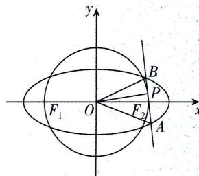

17. (本小题满分 15 分) [广东佛山 2024 高二月考] 在平面直角坐标系 $xOy$ 中, 椭圆 $C$ 过点 $\left(\sqrt{3}, \frac{1}{2}\right)$ , 焦点 $F_{1}(-\sqrt{3}, 0), F_{2}(\sqrt{3}, 0)$ , 圆 $O$ 的直径为 $F_{1}F_{2}$ .

(1)求椭圆 C 及圆 O 的方程.

(2)设直线 l 与圆 O 相切于第一象限内的点 P, 直线 l 与椭圆 C 交于 A, B 两点. 若 $\triangle OAB$ 的面积为 $\frac{2\sqrt{6}}{7}$ , 求直线 l 的方程.

## 相关知识点

暂无已审核的相关知识点。

> 来源：2026版 必刷题 数学选择性必修第一册RJA
