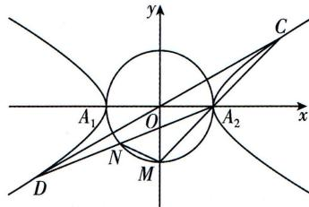

19. (本小题满分 17 分) [江苏镇江 2024 高二期中] 已知双曲线 $E: \frac{x^2}{3} - y^2 = 1$ 的左、右顶点分别为 $A_1, A_2$ .

(1) 若过点 $T(0, -3)$ 的直线 $l$ 交双曲线 $E$ 于 $A, B$ 两点, 求直线 $l$ 的斜率范围;

(2)过原点的直线与双曲线 E 相交于 C, D 两点 (C 在 x 轴的上方), 直线 $A_{2}C, A_{2}D$ 与圆 $x^{2} + y^{2} = 3$ 的另一个交点分别为 M, N, 直线 CD 与直线 MN 的斜率分别为 $k_{1}, k_{2}$ , 求 $k_{1} + k_{2}$ 的值.

错题本

## 相关知识点

暂无已审核的相关知识点。

> 来源：2026版 必刷题 数学选择性必修第一册RJA
