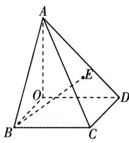

1. [湖南长沙 2024 高二期中]
《九章算术》是我国一部数学经典著作,其在卷第五《商功》中描述的几何体“阳马”实为“底面为矩形,一侧棱垂直于

底面的四棱锥”. 如图, 在 “阳马” A-OBCD 中, E 为 $\triangle ACD$ 的重心, 若 $\overrightarrow{AB} = a, \overrightarrow{AC} = b, \overrightarrow{AD} = c$ , 则 $\overrightarrow{BE} =$ ( )
A. $-a+\frac{1}{2}b+\frac{1}{2}c$ B. $-a+\frac{1}{3}b+\frac{1}{3}c$ C. $a+\frac{2}{3}b+\frac{2}{3}c$ D. $-a+\frac{1}{3}b-\frac{1}{3}c$

## 相关知识点

暂无已审核的相关知识点。

> 来源：2026版 必刷题 数学选择性必修第一册RJA
