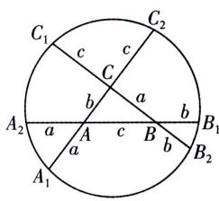

3.[福建泉州多校2025高二联考]“康威圆定理”是英国数学家约翰·康威引以为豪的研究成果之一.定理的内容是这样的:如图,△ABC

的三条边长分别为 $BC = a, AC = b, AB = c$ ，延长线段 $CA$ 至点 $A_{1}$ ，使得 $AA_{1} = a$ ，以此类推得到点

$A_{2},B_{1},B_{2},C_{1}$ 和 $C_{2}$ ，那么这六个点共圆，这个圆称为康威圆。已知 a=4, b=3, c=5，则由 $\triangle ABC$ 生成的康威圆的半径为（）
A. $\sqrt{37}$ B. $\sqrt{39}$ C. $\sqrt{41}$ D. $\sqrt{43}$

