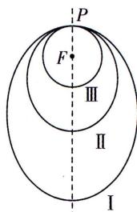

5. (多选) [陕西咸阳 2025 高二期中] 如图所示, 探月卫星沿地月转移轨道飞向月球, 在月球附近一点 $P$ 变轨进入以月球球心 $F$ 为一个焦点的椭圆轨道 I 绕月飞行, 之后卫星在 $P$ 点第二次变轨

进入仍以 $F$ 为一个焦点的椭圆轨道 $\mathrm{II}$ 绕月飞行, 最终卫星在 $P$ 点第三次变轨进入以 $F$ 为圆心的圆形轨道 $\mathrm{III}$ 绕月飞行. 若用 $2c_{1}$ 和 $2c_{2}$ 分别表示椭圆轨道 $\mathrm{I}$ 和 $\mathrm{II}$ 的焦距, 用 $2a_{1}$ 和 $2a_{2}$ 分别表示椭圆轨道 $\mathrm{I}$ 和 $\mathrm{II}$ 的长轴的长, 给出下列式子: ① $a_{1} + c_{1} = a_{2} + c_{2}$ ; ② $a_{1} - c_{1} = a_{2} - c_{2}$ ; ③ $c_{1}a_{2} > a_{1}c_{2}$ ; ④ $\frac{c_{1}}{a_{1}} < \frac{c_{2}}{a_{2}}$ . 其中正确的式子是 ( ) A. ① B. ② C. ③ D. ④

