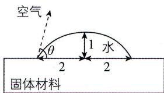

8. (多选) [四川成都树德中学 2025 阶段测试] 某科幻小说中的“水滴”是使用新型材料——强互作用力材料所制成的宇宙探测器, 其外形与水滴相似, 某科研小组研发的新材料水滴角测试结果如图所示 (水滴角可看作液、固、气三相交点处, 气一液两相界面的切线与液一固两相交线所成的角), 圆法和椭圆法是测量水滴角的常用方法, 即将水滴轴截面看成圆或者椭圆 (长轴平行于液一固两者的相交线, 椭圆的短半轴长小于圆的半径) 的一部分, 设图中用圆法和椭圆法测量所得水滴角分别为 $\theta_{1}, \theta_{2}$ , 则下列结论中正确的有 ( )

附: 椭圆 $\frac{x^{2}}{a^{2}} + \frac{y^{2}}{b^{2}} = 1 (a > b > 0)$ 上一点 $(x_{0}, y_{0})$ 处的切线方程为 $\frac{x_{0}x}{a^{2}} + \frac{y_{0}y}{b^{2}} = 1$ .

A. 圆法中圆的半径为 $\frac{5}{2}$ B. $\tan \theta_{1} = \frac{2}{3}$

C. $\theta_{1} > \theta_{2}$ D. $\theta_{1} < \theta_{2}$

