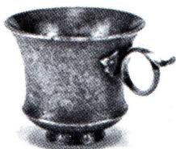
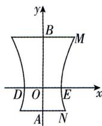

9. (多选) 如图为陕西博物馆收藏的国宝——唐金筐宝钿团花纹金杯, 杯身曲线内收, 巧夺天工, 是唐代金银细作的典范. 该杯的主体部分可以近似看作是双曲线 $C: \frac{x^2}{a^2} - \frac{y^2}{b^2} = 1 (a > 0, b > 0)$ 的右支与直线 $x = 0, y = -2, y = 4$ 围成的曲边四边形ABMN绕 $y$ 轴旋转一周得到的几何体. 若该金杯主体部分的上口外直径为 $\frac{10\sqrt{3}}{3}$ , 下底外直径为 $\frac{2\sqrt{39}}{3}$ , 双曲线 $C$ 与坐标轴交于 $D, E$ 两点, 则 ( )

A. 双曲线 C 的方程为 $\frac{x^{2}}{3}-\frac{y^{2}}{9}=1$ B. 双曲线 $\frac{y^{2}}{3}-x^{2}=1$ 与双曲线 C 共渐近线
C. 存在一点, 使过该点的任意直线与双曲线 C 有两个交点
D. 双曲线 C 上存在无数个点, 使它与 D, E 两点的连线的斜率之积为 3

