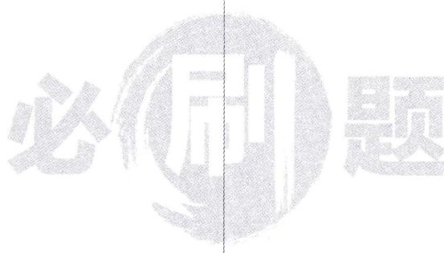

10.[河北邯郸2024高二期中]定义在平面直角坐标系 $xOy$ 中, 把到定点 $F_{1}(-a,0), F_{2}(a,0)$ 距离之积等于 $a^{2}(a > 0)$ 的点的轨迹称为双纽线 $C$ . 已知点 $P(x_0, y_0)$ 是双纽线 $C$ 上一点, 则下列说法中正确的是 \_\_\_\_. (填上你认为的所有正确说法的序号)
① 双纽线 $C$ 关于原点 $O$ 中心对称;
② 双纽线 $C$ 上满足 $|PF_1| = |PF_2|$ 的点 $P$ 只有 1 个;
③ $-\frac{a}{4} \leqslant y_0 \leqslant \frac{a}{4}$ ;
④ $|PO|$ 的最大值为 $\sqrt{2} a$ .

错题本

## 相关知识点

暂无已审核的相关知识点。

> 来源：2026版 必刷题 数学选择性必修第一册RJA
