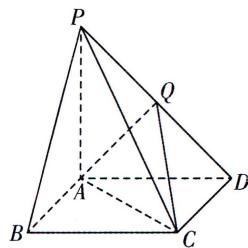

3. (条件开放) [北京大兴区 2025 高二期中] 在四棱锥 $P-ABCD$ 中, 底面 $ABCD$ 是正方形, $Q$ 为 $PD$ 的中点, $PA \perp AD$ , $PA = AB = 2$ , 再从条件①、条件②这两个条件中任选一个作为已知.

(1)求证: $PA \perp$ 平面 ABCD;

(2)求平面 $ACQ$ 与平面 $ABCD$ 夹角的余弦值;

(3)求点 $B$ 到平面 $ACQ$ 的距离.

条件①: 平面 PAD⊥平面 ABCD;

条件②: $PA \perp AB$ .

注:如果选择两个条件分别解答,按第一个解答计分.

