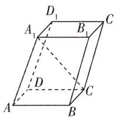

2. 如图, 在平行六面体 $ABCD-A_{1}B_{1}C_{1}D_{1}$ 中, 底面是边长为 1 的正方形. 若 $\angle A_{1}AB = \angle A_{1}AD = 60^{\circ}$ , 且 $A_{1}A = 3$ , 则 $A_{1}C$ 的长为 (A. $\sqrt{5}$ B. $2\sqrt{2}$ C. $\sqrt{14}$ D. $\sqrt{17}$ )

