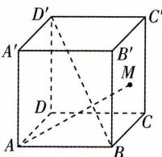

13. [山东济宁一中 2025 高二月考] 如图所示, 在正方体 $ABCD - A'B'C'D'$ 中, $AB = 3$ , $M$ 是侧面 $BCC'B'$ 内的动点, 满足 $AM \perp BD'$ . 若 $AM$ 与平的角为 $\theta$ , 则 $\tan \theta$ 的最大值为

点, 满足 $AM \perp BD'$ . 若 AM 与平面 $BCC'B'$ 所成的角为 $\theta$ , 则 $\tan \theta$ 的最大值为 \_\_\_\_.

不必等候微光，此后若没有炬火，我便是唯一的光明。

