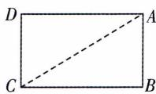
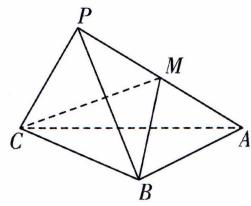

16. (本小题满分 15 分) [安徽多校 2025 高二联考] 如图①, 在矩形 $ABCD$ 中, $AB = 2$ , $BC = 2\sqrt{3}$ , 连接 $AC$ , $\triangle DAC$ 沿 $AC$ 折起到 $\triangle PAC$ 的位置, 如图②, $PB = \sqrt{10}$ .

(1) 求证: 平面 $PAC \perp$ 平面 $ABC$ ;

(2) 若点 M 是线段 PA 的中点, 求平面 MBC 与平面 PAB 夹角的余弦值.

图①

图②

