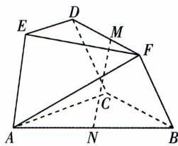

18. (本小题满分 17 分) [湖北武汉华中师范大学第一附属中学 2024 高二期中] 如图, 在多面体 $ABCDEF$ 中, 侧面 $BCDF$ 为菱形, 侧面 $ACDE$ 为直角梯形, $AC \parallel DE$ , $AC \perp CD$ , $N$ 为 $AB$ 的中点, 点 $M$ 为线段 $DF$ 上一动点, 且 $BC = 2\sqrt{3}$ , $AC = 2DE$ , $\angle DCB = 120^\circ$ .

(1) 若点 $M$ 为线段 $DF$ 的中点, 证明: $MN \parallel$ 平面 $ACDE$ .

(2) 若平面 $BCDF \perp$ 平面 $ACDE$ , 且 $DE = 2$ , 问: 线段 $DF$ 上是否存在点 $M$ , 使得直线 $MN$ 与平面 $ABF$ 所成角的正弦值为 $\frac{3}{10}$ ? 若存在, 求出 $\frac{DM}{DF}$ 的值; 若不存在, 请说明理由.

