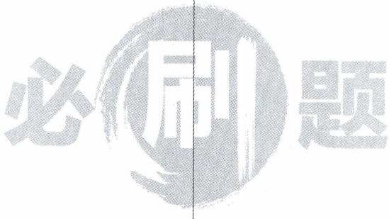

19. (本小题满分 17 分) [湖南多校 2025 高二联考] 若将任意平面向量 $\overrightarrow{EF} = (x, y)$ 绕其起点 $E$ 沿逆时针方向旋转 $\alpha$ 角, 得到向量 $\overrightarrow{EK} = (x\cos \alpha - y\sin \alpha, x\sin \alpha + y\cos \alpha)$ , 则称点 $F$ 绕点 $E$ 逆时针方向旋转 $\alpha$ 角得到点 $K$ . 曲线 $7x^{2} + 7y^{2} + 2xy = 96$ 是由椭圆 $C: \frac{y^{2}}{a^{2}} + \frac{x^{2}}{b^{2}} = 1 (a > b > 0)$ 在平面直角坐标系中绕原点 $O$ 逆时针旋转 $\frac{\pi}{4}$ 所得的斜椭圆 $\Omega$ .

(2)已知 M, N 是椭圆 C 长轴的两个顶点，P, Q 为椭圆 C 上异于 M, N 且关于 y 轴对称的两点. 若直线 MP 与直线 NQ 交于点 T, 证明点 T 在某定曲线上，并求出该曲线的方程.

(3) 过椭圆 C 的上焦点作平行于 x 轴的直线 m，交椭圆 C 于 A, B 两点，D 是抛物线 $\Gamma: y = \frac{2}{9}x^{2}$ 上不同于点 A, B 的动点。若直线 DA 与椭圆 C 的另一个交点为 G，直线 DB 与椭圆 C 的另一个交点为 H，试问直线 HG 是否过定点？若是，求该定点的坐标；若不是，请说明理由。

