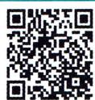
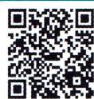

6.(多选)已知x,y,z为非零实数,代数式 $\frac{x}{|x|}+\frac{y}{|y|}+\frac{z}{|z|}+\frac{|xyz|}{xyz}$ 的值所组成的集合是M,则下列判断正确的是()A. $0\notin M$ B. $2\in M$ C. $-4\in M$ D. $4\in M$

注:2024 表示 2023\~2024 学年,2025 表示 2024\~2025 学年。

