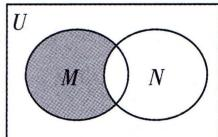

3.[安徽合肥一六八中学2025高一期中]若全集 $U=\mathbf{R}$ ，集合 $M=\{x\mid0<x\leqslant3\},N=\{y\mid y=x^{2}+1\}$ ，则图中阴影部分表示的集合为（）

建议用时:30 分钟 答案 P151

A. $\{x\mid 0 <   x <   1\}$ B. $\{x\mid 0\leqslant x <   1\}$ C. $\{x\mid 0 <   x\leqslant 1\}$ D. $\{x\mid 0\leqslant x\leqslant 1\}$

## 相关知识点

暂无已审核的相关知识点。

> 来源：2026版 高中必刷题数学必修第一册
