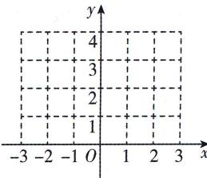

7.[江苏南通部分学校2025高一期中联考]已知函数 $f(x)=|x+a|+|x-a|$ ， $g(x)=-x^{2}+2ax+4a$ ，其中 $a\geqslant1$ (1) 当 $a=1, x \in [-2, 2]$ 时，请在指定直角坐标系中，画出函数 $f(x)$ 的图象；
(2) 用 $M(x)$ 表示 $f(x), g(x)$ 中的较大者，记为 $M(x) = \max\{f(x), g(x)\}$ ，则当 x > 0 时，求函数 $M(x)$ 的解析式；
(3) 用 $m(x)$ 表示 $f(x), g(x)$ 中的较小者，记为 $m(x) = \min\{f(x), g(x)\}$ ，若 $\min\{f(x), g(x)\} \leqslant 8$ 恒成立，求实数 a 的取值范围.

