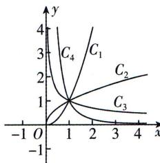

6. 教材变式 [湖南株洲 2024 高一期中] 如图的曲线是幂函数 $y = x^n$ 在第一象限内的图象. 已知 $n$ 分别取 ±2, ± $\frac{1}{2}$ 四个值, 与曲线 $C_1, C_2, C_3, C_4$ 相应的 $n$ 依次为 ( )

A. $2, \frac{1}{2}, -\frac{1}{2}, -2$ B. $2, \frac{1}{2}, -2, -\frac{1}{2}$ C. $-\frac{1}{2}, -2, 2, \frac{1}{2}$ D. $-2, -\frac{1}{2}, \frac{1}{2}, 2$

## 相关知识点

暂无已审核的相关知识点。

> 来源：2026版 高中必刷题数学必修第一册
