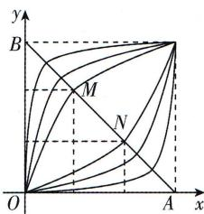

3.[江苏南通如皋中学2025高一期末]已知幂函数 $y=x^{\alpha}$ ，当 $\alpha$ 取不同的正数时，在区间 $[0,1]$ 上它们的图象是一簇曲线（如图）.设点A(1,

0), $B(0,1)$ ，连接 $AB$ ，线段 $AB$ 恰好被其中的两个幂函数 $y = x^{\alpha}, y = x^{\beta}$ 的图象三等分，即有 $BM = MN = NA$ ，那么 $\alpha \beta =$ （ ）A. $\frac{1}{3}$ B. $\frac{2}{3}$ C. 1 D. 3

