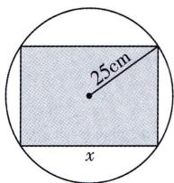

2.[湖南长沙长郡中学2024高一期中]如图,把直截面半径为25cm的圆柱形木头锯成直截面为矩形的木料,如果矩形的一边长为x(单位:cm),面积为y(单位:cm²),那么把y表示为x的函数的解析式为
A. $y=x\cdot\sqrt{2500-x^{2}}$ B. $y=x\cdot\sqrt{2500-x^{2}},0<x<50$ C. $y=x\cdot\sqrt{625-x^{2}}$ D. $y=x\cdot\sqrt{625-x^{2}},0<x<50$

## 相关知识点

暂无已审核的相关知识点。

> 来源：2026版 高中必刷题数学必修第一册
