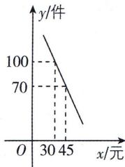

5.[江苏扬州高邮一中2025高一月考]某主播在直播平台上销售一款成本为每件24元的商品.经调查发现,该商品每天的销售量y(件)与销售单价x(元)之间满足一次函数关系,其图象如图所示.
(1)求该商品每天的销售量y与销售单价x之间的函数关系式.
(2)若该主播按单价不低于成本价,且不高于50元销售,则销售单价定为多少元时利润最大?最大利润是多少?
(3)若该主播要使销售该商品每天获得的利润不低于1280元,则每天的销售量最少应为多少件?

## 相关知识点

暂无已审核的相关知识点。

> 来源：2026版 高中必刷题数学必修第一册
