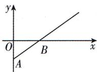
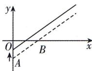
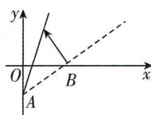

12. (多选)[浙江台金七校 2025 高一期中联考] 如图①是反映某条公交线路收支差额(即营运所得票价收入与付出成本的差)y 与乘客量 x 之间关系的图象. 由于目前该条公交线路亏损, 公司有关人员提出了两种调整的建议, 如图②③所示.

图①

图②

图③

则下列说法中正确的有 ( )
A. 图②的建议: 提高成本, 并提高票价
B. 图②的建议: 降低成本, 并保持票价不变
C. 图③的建议: 提高票价, 并保持成本不变
D. 图③的建议: 提高票价, 并降低成本

