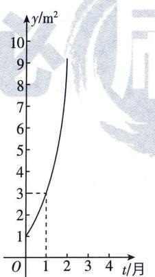

4.(多选)如图,某湖泊蓝细菌的面积y(单位: $m^{2}$ )与时间t(单位:月)的关系满足 $y=a^{t}$ ,则下列说法正确的是()A.蓝细菌面积每个月的增长率为200%B.蓝细菌每个月增加的面积都相等

C. 第4个月时,蓝细菌面积就会超过 $80\ m^{2}$ D. 若蓝细菌的面积蔓延到 $2 \, m^{2}, 4 \, m^{2}, 8 \, m^{2}$ 所经过的时间分别是 $t_{1}, t_{2}, t_{3}$ ，则一定有 $2t_{2} = t_{1} + t_{3}$

## 相关知识点

暂无已审核的相关知识点。

> 来源：2026版 高中必刷题数学必修第一册
