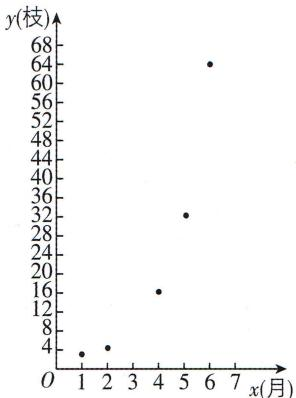

2. “红豆生南国, 春来发几枝”, 如图给出了红豆生长时间 x (月) 与枝数 y (枝) 的散点图 (直角坐标系中作出 $(x, y)$ 对应的点), 那么最符合红豆的枝数与生长时间的关系的函数是 ( )
A. 指数函数 $y = 2^{x}$ B
C. 幂函数 $y = x^{3}$ D系的函数是 ( )
A. 指数函数 $y=2^{x}$ B. 对数函数 $y=\log_{2}x$ C. 幂函数 $y = x^{3}$ D. 二次函数 $y = 2x^{2}$

