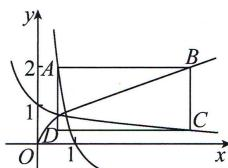

14. 如图, 矩形 ABCD 的三个顶点 A, B, C 分别在函数 $y = \log_{\frac{\sqrt{2}}{2}} x$ , $y = x^{\frac{1}{2}}$ , $y = \left(\frac{\sqrt{2}}{2}\right)^x$ 的图象上, 且矩形的边分别平行于两坐标轴. 若点 A 的纵坐标为 2, 则点 D 的坐标为 \_\_\_\_.

## 四、解答题:本大题共5小题,共77分. 解答应写出文字说明,证明过程或演算步骤.

## 相关知识点

暂无已审核的相关知识点。

> 来源：2026版 高中必刷题数学必修第一册
