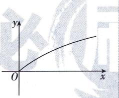

17.(本小题满分15分)[江苏南京六校2025高一联考]某校为了鼓励学生利用业余时间阅读名著,预备制定一个每日阅读考核评分制度,建立一个每日得分y(单位:分)与当日阅读时间x(单位:分钟)的函数关系.要求如下:(i)函数的部分图象接近图示;(ii)每日阅读时间为0分钟时,当日得分为0分;(iii)每日阅读时间为30分钟时,当日得分为3分;(iv)每日阅读最多得分不超过6分.
现有以下三个函数模型供选择:
① $y=kx+m(k>0)$ ;
② $y=k\cdot1.1^{x}+m(k>0)$ ;
③ $y=k\log_{2}\left(\frac{x}{15}+2\right)+m(k>0)$ .
(1)请你根据函数图象性质,从中选择一个合适的函数模型,不需要说明理由.
(2)根据你对(1)的判断以及所给信息,写出合适函数模型的解析式.
(3)若该校要求每日的得分不少于5分,问每日至少阅读名著多少分钟?(结果精确到整数)
注: $2^{\frac{8}{3}}\approx6.35$ .

## 相关知识点

暂无已审核的相关知识点。

> 来源：2026版 高中必刷题数学必修第一册
