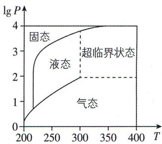

3. 已知函数 $f(x) = \begin{cases} \frac{2}{\sqrt{2 - x}} - a \cdot 2^{-x}, & x \leqslant 0, \\ \log_{\frac{1}{4}} x, & x > 0. \end{cases}$ (1) 若 $\forall x_1 \in (-\infty, 0]$ , $\exists x_2 \in [1, +\infty)$ , 使得 $f(x_1) = f(x_2)$ , 求解关于 $a$ 的方程 $f(f(0)) = 0$ ;

所有的美好都藏于时间的缝隙里,让生活变成了有光照进来的地方。

A. 当 $T = 220, P = 1026$ 时, 二氧化碳处于液态
B. 当 $T = 270, P = 128$ 时, 二氧化碳处于气态
C. 当 $T = 300, P = 9987$ 时, 二氧化碳处于超临界状态
D. 当 $T = 360, P = 729$ 时, 二氧化碳处于超临界状态

## 相关知识点

暂无已审核的相关知识点。

> 来源：2026版 高中必刷题数学必修第一册
