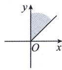
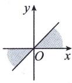
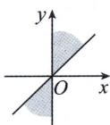
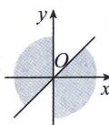

9. 若角 $\alpha$ 的顶点与原点重合, 始边与 x 轴的非负半轴重合, 则集合 $\{\alpha \mid k \cdot 180^{\circ} + 45^{\circ} \leqslant \alpha \leqslant k \cdot 180^{\circ} + 90^{\circ}, k \in Z\}$ 中的角 $\alpha$ 的终边在图中的位置 (阴影部分) 是 ( )

A

B

C

D

无聊者自厌，寂寞者自怜，孤独者自足，庸人无聊，天才孤独，人人都有寂寞的时光。

