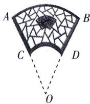

15. 扇子最早称“翣”, 其功能并不是纳凉, 而是礼仪用具, 后用于纳凉、娱乐、欣赏等. 扇文化是中国传统文化的重要门类, 扇子的美学也随之融入建筑等艺术审美之中. 图①为一古代扇形窗子, 此窗子所在扇形的半径 (图②) $AO = 80 \mathrm{~cm}$ , 圆心角为 $45^{\circ}$ , 且 $C$ 为 $AO$ 的中点, 则该扇形窗子的面积为 ( )

图①
图②

A. $108000\mathrm{cm}^2$ B. $108000\pi \mathrm{cm}^2$ C. $600\pi \mathrm{cm}^2$ D. $600\mathrm{cm}^2$

