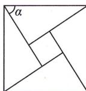

5. 我国古代数学家赵爽在注解《周髀算经》一书时介绍了“赵爽弦图”，如图所示，它是由四个全等的直角三角形与一个小正方形拼成的大正方形，记直角三角形中较大的锐角为 $\alpha$ ，大正方形的边长为 a，小正方形的边长为 b，若 $\frac{\sin \alpha (1 - 2\sin \alpha \cos \alpha)}{\sin \alpha - \cos \alpha} = \frac{2}{5}$ ，则 $\frac{b}{a} =$ （）
A. $\frac{\sqrt{5}}{5}$ B. $\frac{2\sqrt{5}}{5}$ C. $\frac{1}{2}$ D. $\frac{2}{3}$

建议用时:30 分钟 答案 P230
