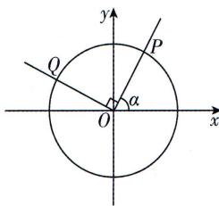

8.[广东部分学校2025高一期末联考]如图,在平面直角坐标系中,锐角 $\alpha$ 的终边与单位圆交于点 $P\left(\frac{\sqrt{5}}{5},m\right)$ ,将角 $\alpha$ 的终边按逆时针方向旋转 $\frac{\pi}{2}$ 后得到角 $\beta$ 的终边,并与单位圆交于点Q.
(1) 求点 Q 的坐标;

(2) 求 $\frac{\sin\left(\frac{\pi}{2}-\alpha\right)\cos(\pi-\beta)}{\sqrt{5}\cos(2025\pi+\beta)+2\tan(\pi-\beta)}$ 的值.

## 相关知识点

暂无已审核的相关知识点。

> 来源：2026版 高中必刷题数学必修第一册
