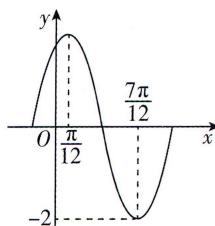

9. (多选) [广西示范性高中 2024 高一联考] 已知函数 $f(x) = A \sin (\omega x + \varphi) (A > 0, \omega > 0, 0 < \varphi < \pi)$ 的部分图象如图所示, 则下列结论正确的是

A. 函数 $f(x)$ 的最小正周期为 $\pi$ B. 直线 $x = \frac{\pi}{3}$ 是 $f(x)$ 图象的一条对称轴
C. 点 $\left(\frac{5\pi}{6},0\right)$ 是 $f(x)$ 图象的一个对称中心
D. 点 $\left(-\frac{\pi}{3},0\right)$ 是 $f(x)$ 图象的一个对称中心
