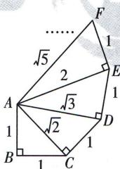

4. 希腊数学家泰特托斯（Theaetetus，公元前417—公元前369年）详细地讨论了无理数的理论，他通过如图来构造无理数 $\sqrt{2}, \sqrt{3}, \sqrt{5}, \cdots$ ，则 $\sin \angle BAD =$ （ ）A. $\frac{2\sqrt{6} + 3\sqrt{3}}{6}$ B. $\frac{2\sqrt{6} - 3\sqrt{3}}{6}$ C. $\frac{2\sqrt{3} + \sqrt{6}}{6}$ D. $\frac{2\sqrt{3} - \sqrt{6}}{6}$

