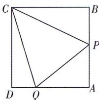

15. [河南开封 2025 高一期末] 如图, 正方形 ABCD 的边长为 1, P, Q 分别为边 AB, AD 上的动点.
(1) 设 $\angle BCP = \alpha, \angle DCQ = \beta$ , 请用含有 $\alpha, \beta$ 的式子表示 $\triangle APQ$ 的周长 t;
(2) 若点 P, Q 在运动的过程中, $\angle PCQ$ 的大小保持不变, 试探究 $\triangle APQ$ 的周长 t 的变化情况.

