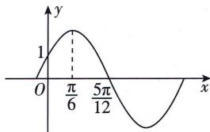

9. 已知函数 $f(x)=A\sin(\omega x+\varphi)$ (A>0, $\omega>0$ , $0<\varphi<\frac{\pi}{2}$ ) 的部分图象如图所示，则函数 $f(x)$ 的解析式为 ( )

A. $f(x) = \sqrt{2}\sin \left(x + \frac{\pi}{3}\right)$ B. $f(x) = 2\sin \left(x + \frac{\pi}{3}\right)$ C. $f(x) = \sqrt{2}\sin \left(2x + \frac{\pi}{4}\right)$ D. $f(x) = 2\sin \left(2x + \frac{\pi}{6}\right)$

## 相关知识点

暂无已审核的相关知识点。

> 来源：2026版 高中必刷题数学必修第一册
