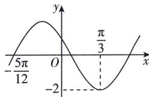

14. (多选)[吉林长春六中2025高一期末]已知函数 $f(x)=\cos\omega x-\sqrt{3}\sin\omega x(\omega>0)$ 的部分图象如图所示,则下列选项正确的是()

A. 函数 $f(x)$ 的图象关于点 $\left(\frac{7\pi}{12},0\right)$ 中心对称
B. 函数 $f(x)$ 的单调递增区间为 $\left[k\pi-\frac{2\pi}{3},k\pi-\frac{\pi}{6}\right](k\in\mathbf{Z})$

C. 函数 $f(x)$ 的图象可由 $y=2\sin\omega x$ 的图象向左平移 $\frac{5\pi}{6}$ 个单位长度得到
D. 函数 $g(x)=f(t\omega x)(t>0)$ 在 $(0,\pi)$ 上有 2 个零点，则实数 t 的取值范围为 $\left(\frac{7}{24},\frac{13}{24}\right]$
