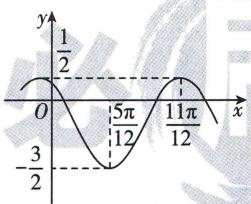

16.[山西名校联合体2025高一期末联考]已知函数 $f(x)=A\sin(\omega x+\varphi)+B(A>0,\omega>0,0<\varphi<\pi)$ 的图象如图所示.

(1) 求函数 $f(x)$ 的解析式；

(2) 将函数 $f(x)$ 的图象上所有点的横坐标缩短为原来的 $\frac{1}{2}$ ，再向右平移 $\frac{\pi}{3}$ 个单位长度，得到函数 $y = g(x)$ 的图象，若 $x \in \left[-\frac{\pi}{24}, \frac{\pi}{4}\right]$ ，求函数 $g(x)$ 的值域.

