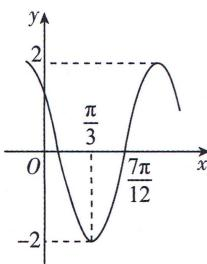

3.[山西部分地区2025高一期末联考]已知函数 $f(x)=A\cos(\omega x+\varphi)\left(A>0,\omega>0,|\varphi|<\frac{\pi}{2}\right)$ 的部分图象如图所示,将函数 $f(x)$ 的图象向右平移 $\frac{\pi}{4}$ 个单位长度得到函数 $g(x)$ 的图象,则() A. $g(x)=2\sin\left(x-\frac{\pi}{3}\right)$

建议用时:50 分钟 答案 P256

B. $g(x) = 2\sin \left(2x + \frac{\pi}{3}\right)$ C. $g(x) = 2\cos \left(x - \frac{\pi}{3}\right)$ D. $g(x) = 2\cos \left(2x + \frac{\pi}{3}\right)$

