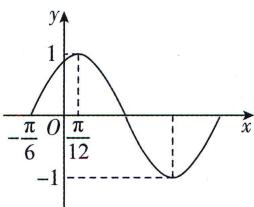

12.[安徽芜湖一中2025高一期末]已知函数 $f(x)=A\sin(\omega x+\varphi)\left(A>0,\omega>0,-\frac{\pi}{2}<\varphi<\frac{\pi}{2}\right)$ 在一个周期内的图象如图所示.
(1) 求函数 $f(x)$ 的最小正周期 T 及 $f(x)$ 的解析式；
(2) 求函数 $f(x)$ 的图象的对称轴方程及单调递增区间；
(3) 将 $f(x)$ 的图象向右平移 $\frac{\pi}{3}$ 个单位长度，再将所得图象上所有点的横坐标伸长为原来的2倍（纵坐标不变），得到函数 $g(x)$ 的图象，若 $g(x)=a-1$ 在 $\left[\frac{\pi}{2},\frac{3\pi}{2}\right]$ 上有两个解，求实数 a 的取值范围.

## 相关知识点

暂无已审核的相关知识点。

> 来源：2026版 高中必刷题数学必修第一册
