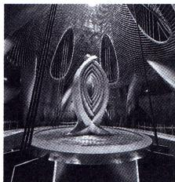
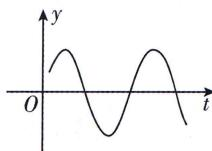

3.[江苏扬州中学2024高一月考]阻尼器是一种以提供阻力达到减震效果的专业工程装置.我国第一高楼上海中心大厦的阻尼器减震装置,被称为“定楼神器”,如图①.由物理学知识可知,某阻尼器的运动过程可近似为单摆运动,

错题本

√ 答案 P258

其离开平衡位置的位移 $y$ （单位：m）和时间 $t$ （单位：s）的函数关系为 $y = \sin (\omega t + \varphi) (\omega > 0, |\varphi| < \pi)$ ，如图②，若该阻尼器在摆动过程中连续三次位移为 $s_0 (-1 < s_0 < 1)$ 的时间分别为 $t_1, t_2, t_3 (0 < t_1 < t_2 < t_3)$ ，且 $t_1 + t_2 = 2, t_2 + t_3 = 5$ ，则在一个周期内阻尼器离开平衡位置的正向位移大于 $0.5 \mathrm{~m}$ 的总时间为 （）

图①

图②

A. $\frac{1}{3}\mathrm{s}$ B. $\frac{2}{3}\mathrm{s}$ C. $1\mathrm{s}$ D. $\frac{4}{3}\mathrm{s}$

## 相关知识点

暂无已审核的相关知识点。

> 来源：2026版 高中必刷题数学必修第一册
